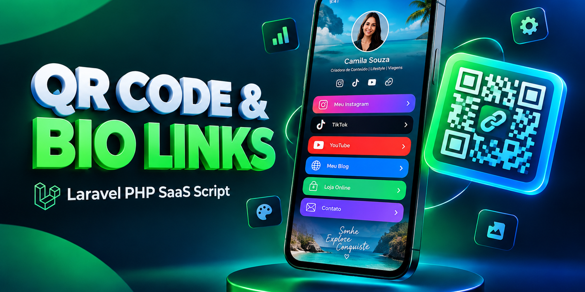
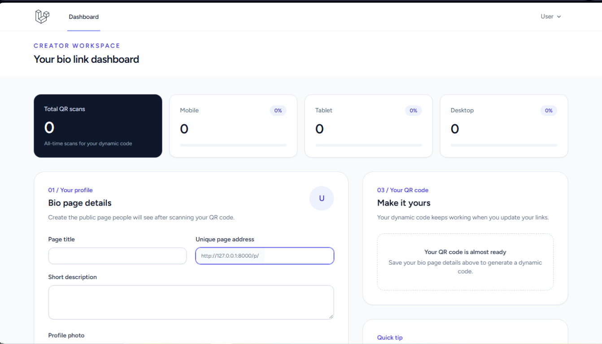
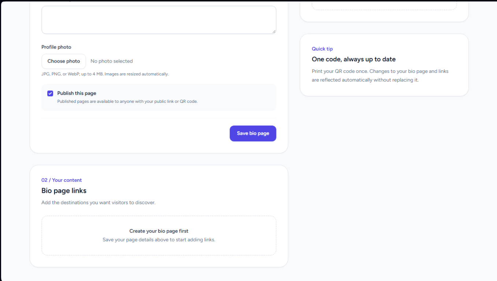

# Turn Every Scan Into a Branded Destination

**A Laravel-powered bio link and dynamic QR code platform for creators, entrepreneurs, and businesses. Build a polished profile page, share it anywhere, and understand how your audience finds you.**

| [🚀 **TRY THE LIVE DEMO**](https://dynamic-qr-code-demo-production.up.railway.app) | [🛍️ **GET THE FULL SCRIPT ON CODESTER**](https://www.codester.com/items/74793/dynamic-qr-codes-and-bio-links-saas?ref=JuDevLab) |
|:---:|:---:|

**Demo login**

```text
Email:    demo@example.com
Password: password123
```

> This is a public product showcase. It includes marketing assets and project metadata only; the application source code is not included.

## Commercial Description

Give your audience one memorable place to discover everything you do. **Dynamic QR Code Generator with Bio Links** brings a customizable bio page and a reusable dynamic QR code together in one easy-to-manage platform. Share a single link across social profiles, business cards, packaging, event signage, or printed materials, then let visitors choose the destination that matters to them.

Create a public profile with your own title, description, photo, and links. When your destinations change, update them from your dashboard without replacing the QR code you have already shared. Customize the code's colors, optionally add a center logo, and download it as an SVG for sharp, flexible use in digital and print designs.

The creator dashboard gives you a quick view of scan activity, including mobile, tablet, and desktop breakdowns. Whether you are building a personal brand, promoting a small business, or connecting an offline campaign to your online presence, this script provides a practical foundation for a polished, trackable link-in-bio experience.

## Key Features

### A bio page that puts your brand first

- Create and publish a public bio page with a unique address.
- Add a page title, short description, profile photo, and multiple destination links.
- Manage your profile and links from an authenticated creator dashboard.
- Keep your audience's destinations current from one central page.



### Dynamic QR codes built for sharing

- Generate a QR code that points to your dynamic scan URL.
- Update the connected bio page and links without replacing the shared code.
- Customize QR code colors and optionally add a centered logo.
- Preview the QR code and download it as an SVG.
- Track scan timestamps and device categories: mobile, tablet, and desktop.
- Analytics record device category without storing raw IP addresses or raw User-Agent strings.

### A streamlined content editing experience

- Organize your public page details and bio links in the dashboard.
- Upload profile photos and QR logos with validation and automatic image resizing.
- Publish or update your page as your content evolves.



### Ready for real-world workflows

- Registration, login, and password reset screens.
- SQLite support for local development and automated tests.
- MySQL support for persistent production installations.
- Laravel-based application structure for maintainable customization.

## Technical Requirements

- **PHP:** 8.3 or later.
- **Composer:** Version 2.
- **Database:** MySQL 8.0 or compatible MariaDB for production; SQLite is supported for local development and tests.
- **PHP extensions:** `gd`, plus `pdo_mysql` for MySQL or `pdo_sqlite` for SQLite. Common Laravel extensions include `ctype`, `curl`, `dom`, `fileinfo`, `mbstring`, `openssl`, `tokenizer`, and `xml`.
- **Frontend tooling:** Node.js and npm versions supported by the included Vite toolchain.
- **Web server:** Apache or Nginx configured to serve Laravel's `public` directory.
- **Production:** HTTPS is recommended; configure the production environment with debugging disabled.

## Explore the Demo

Use the demo account above to try the [live dashboard](https://dynamic-qr-code-demo-production.up.railway.app) and preview the creator workflow.

| [🚀 **OPEN THE LIVE DEMO**](https://dynamic-qr-code-demo-production.up.railway.app) | [🛒 **VIEW THE CODESTER PRODUCT**](https://www.codester.com/items/74793/dynamic-qr-codes-and-bio-links-saas?ref=JuDevLab) |
|:---:|:---:|
